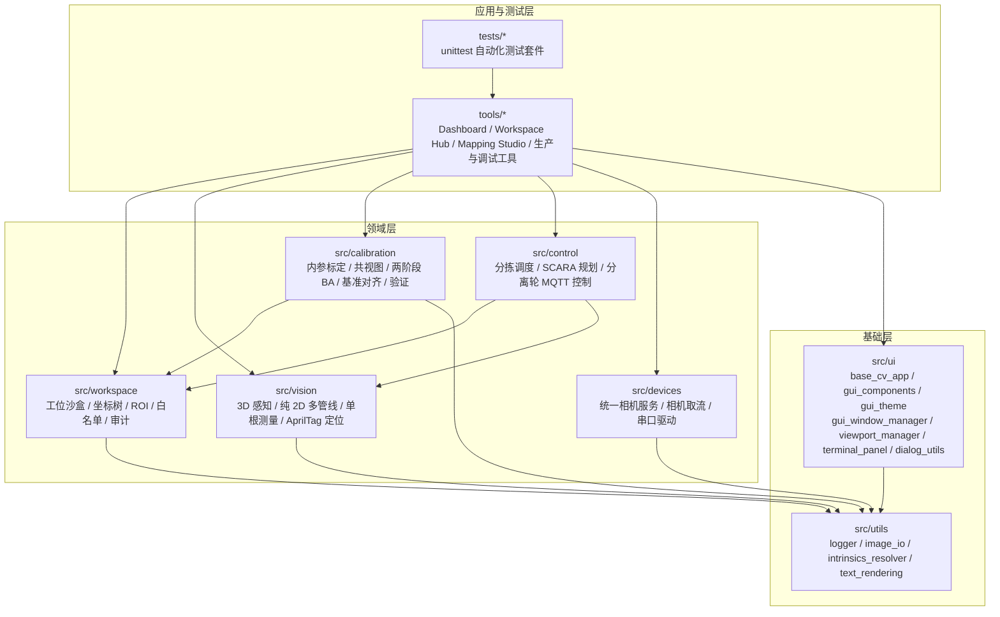
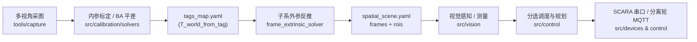

# 系统架构与模块职责

> **定位**：描述 `spatial_vision` 的分层依赖架构、各包职责、核心数据流、配置文件写者矩阵与关键架构决策（ADR）。  
> **读者**：开发者与 AI 编程助手。

---

## 1. 分层依赖架构

系统采用**单向 DAG 分层解耦**（零循环依赖，`src/utils` 为最底层，算法层严格禁止依赖 `src/ui`）：

### 硬性依赖边界
- **算法层禁止依赖 UI 层**：`src/vision`、`src/calibration`、`src/workspace`、`src/control` 严禁 `import src.ui`。跨层文字渲染已下沉至 `src/utils/text_rendering.py`。
- **工具层禁止直连相机驱动**：`tools/*` 严禁直接 `import pyrealsense2` 或操作 `rs.sensor`，所有相机生命周期与曝光控制统一委托 `src/devices/camera_service.py`。
- **渲染器只读隔离**：所有交互工具的 `Renderer` 仅持有状态只读引用并输出命中表，状态变更一律收口在控制器（`BaseCvApp` 子类）中。

---

## 2. `src/` 核心包职责

| 包路径 | 核心模块 | 职责摘要 |
| :--- | :--- | :--- |
| `src/workspace` | `workspace_entity`, `workspace_manager`, `coordinate_manager`, `roi_manager`, `scene_config_guard`, `tag_whitelist_manager`, `health_auditor` | 工位物理沙盒、三大图集路径契约、多坐标系树与 3D ROI、`spatial_scene.yaml` 原子写守卫、标靶白名单与一致性自愈。详见 [workspace_and_scene.md](workspace_and_scene.md) |
| `src/calibration` | `solvers/`（`camera_intrinsics_calibrator`, `covisibility_graph`, `ba_optimizer`, `world_datum_aligner`, `frame_extrinsic_solver`, `multiframe_milestone_solver`）, `verification/`（`ba_uncertainty_analyzer`, `verification_reporter`, `verification_visualizer`, `prism_renderer`）, `manifest_repository`, `offline_tag_extractor`, `tag_super_extractor` | 相机内参标定、离线超精提取、共视拓扑守门、两阶段鲁棒 BA、Umeyama 世界基准对齐、子坐标系外参反推与质检报告。详见 [calibration_pipeline.md](calibration_pipeline.md) |
| `src/vision` | `asparagus_analyzer`, `single_asparagus_measurer`, `pipelines/`（`registry`, `base_pipeline`, `f1/f2/a/b1/b2/c1/c2/h1~h6/y1`, `multi_object_separator`, `occlusion_peeler`）, `tag_detector`, `pnp_solver`, `tag_localizer` | 3D RGB-D 堆叠抓取感知、纯 2D 多管线注册与对比框架、单根芦笋几何测量、AprilTag 在线单帧自定位。详见 [vision_pipelines.md](vision_pipelines.md) |
| `src/control` | `sorting_dispatcher`, `scara_motion_planner`, `isolation_wheel_controller` | Smart ROI 分选调度、SCARA 三段式防撞 G-code 轨迹规划、分离轮 ESP32 MQTT 线程安全控制中枢。详见 [control_and_production.md](control_and_production.md) |
| `src/devices` | `camera_service`, `camera_streamer`, `robot_serial` | RealSense / USB 双后端统一相机服务、异步取流与连拍适配、SCARA Marlin 串口通信驱动 |
| `src/ui` | `base_cv_app`, `gui_components`, `gui_theme`, `gui_window_manager`, `viewport_manager`, `canvas_viewport_interactor`, `terminal_panel`, `dialog_utils` | OpenCV + NumPy 工业暗色 GUI 基座（事件循环、控件、DPI 视口、内嵌终端与跨平台原生对话框） |
| `src/utils` | `logger`, `image_io`, `intrinsics_resolver`, `text_rendering` | 幂等日志、Unicode 安全图像读写（防 Windows 中文路径崩溃）、内参单源解析、PIL TrueType 矢量文字贴图 |

---

## 3. 端到端空间与业务数据流

链条严格单向，严禁下游反向修改上游标定产物。

---

## 4. 配置文件单一写者矩阵 (SSOT)

| 配置文件 | 权威写者 | 契约说明 |
| :--- | :--- | :--- |
| `data/workspaces/<id>/tags_map.yaml` | `ManifestRepository.save_map` | 工位顶层空间几何地图；BA 落盘与 `health_auditor` 自愈统一收敛于此 |
| `data/workspaces/<id>/spatial_scene.yaml` | `SceneConfigGuard` | 路径级 `RLock` + 临时文件 `os.replace` 原子落盘；`CoordinateTreeManager` 与 `RoiSpaceManager` 均委托其写入 |
| `data/workspaces/<id>/tag_whitelist.yaml` | `tag_whitelist_manager.save_workspace_tag_config` | 标靶准入、物理边长 `tag_default_size_mm` 与世界锚点 `xyz_mm` 唯一真理源 |
| `data/workspaces/<id>/intrinsics/camera_intrinsics.yaml` | `CameraIntrinsicsCalibrator` / `Workspace` | 工位专属相机内参矩阵 $K$、畸变系数 $D$ 与锁定物理分辨率 |
| `config/config.yaml` | 手工配置 / 系统参数 | 仅存非空间标定类的硬件、串口、视觉默认参数 |
| `config/gui_settings.json` | `GuiWindowManager` / 各工具 `APP_ID` 子树 | 窗口尺寸与工具偏好持久化；**单元测试必须通过临时路径或 `patch.object` 隔离，禁止污染真实文件** |

---

## 5. 工具链入口总览 (`tools/`)

| 分组 | 工具 | 启动命令 | 核心定位 |
| :--- | :--- | :--- | :--- |
| 总控 | Dashboard | `python tools/gui_launcher.py`（或 `./run.ps1`） | 工业总控大屏，统一调度全部工具与内嵌终端 |
| 工位 | Workspace Hub | `python -m tools.workspace_hub` | 工位生命周期、硬件绑定、三大图集、坐标系树与 3D ROI |
| 标定 | 采图向导 | `python -m tools.capture` | 内参/外参/生产三用途采图与语义前缀归档 |
| 标定 | 空间建图工作站 | `python -m tools.spatial_mapping_studio` | 样本审核、两阶段 BA、残差剪枝与质检闭环 |
| 标定 | AprilTag 图纸生成 | `python tools/generate_apriltags.py` | 生成 16h5（ID 0~29）高清标靶与 A4 排版 PDF |
| 视觉 | 顶层抓取位姿工作室 | `python -m tools.asparagus_pose_studio` | 多根堆叠 3D/纯 2D 多管线对比与参数调试 |
| 视觉 | 单根芦笋测量工作室 | `python -m tools.asparagus_measure_studio` | ROI 内单根芦笋绿色有效长度与 20mm 处直径测量 |
| 生产 | SCARA 抓取生产 | `python -m tools.scara_production` | Smart ROI 进料感知、分选调度与 SCARA 闭环 |
| 生产 | 分离轮生产工作台 | `python -m tools.isolate_wheels_production` | 8 通道分离轮自动循环出料、速度倍率与 PPM 监控 |
| 调试 | Robot 在线跟踪 | `python -m tools.tracker` | 实时 Tag 世界坐标解算与 SCARA 联动校偏 |
| 调试 | RealSense 诊断 | `python tools/d435_viewer.py` | D435 双流实时预览、深度探针与快照抓拍 |
| 调试 | SCARA 机械臂调试 | `python tools/scara_debug/app.py` | 串口点动、回零/设零、舵机与 G-code 透传 |
| 调试 | 分离轮 MQTT 调试 | `python tools/isolate_wheels_debug/app.py` | ESP32 分离轮设备发现、状态监视与单/多轴节拍调试 |
| 调试 | NetCamera 调试 | `python tools/net_camera_debug/app.py` | 手机网络摄像机 MQTT 远程控制与 RTSP 实时拉流 |
| 运维 | 环境诊断 | `python tools/diagnose_env.py` | 依赖库与驱动健康检查 |

---

## 6. 架构决策记录 (ADR)

### ADR-01：维持 OpenCV + NumPy 自研 GUI，不全面迁移 Tkinter
- **结论**：核心实时视窗与交互工具维持 `BaseCvApp`（OpenCV + NumPy + PIL TrueType 贴图）架构，**不全面迁移至 Tkinter**；仅保留 `src/ui/dialog_utils.py` 调用系统原生对话框/Tkinter 处理非实时弹窗（确认框、文本输入、文件选择）。
- **核心依据**：
  1. **实时帧率刚性需求**：工业视觉需 30fps @ 1080P 实时叠加渲染，Tkinter 的 `NumPy → PIL → ImageTk` 管线延迟为 `cv2.imshow` 的 5~15 倍，无法满足。
  2. **跨平台视觉一致性与沉没成本**：现有 `src/ui/` 控件与暗色主题已在 8+ 交互工具中稳定服役且像素级一致，全面重写成本与风险极高。
  3. **未来演进路径**：若后续需要复杂富表单或 GPU 加速 UI，优先评估 DearPyGui 或 PyQt6，而非 Tkinter。
