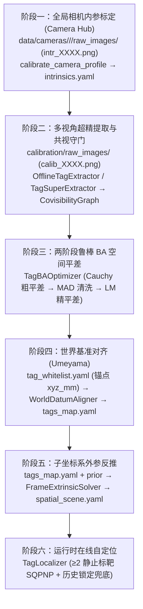

# 相机内参与 AprilTag 空间标定管线

> **定位**：描述 `spatial_vision` 从相机内参标定、多视角 AprilTag 两阶段 BA 空间平差、世界基准对齐、子坐标系外参反推到在线自定位的完整几何管线，并记录 BA 精度物理机理与故障排查。  
> **核心源码**：`src/calibration/`、`src/vision/tag_detector.py`、`src/vision/pnp_solver.py`、`src/vision/tag_localizer.py`、`tools/spatial_mapping_studio/`。

---

## 1. 标定流水线全景

---

## 2. 核心求解器与组件职责

| 模块路径 | 核心类 / 函数 | 职责与输入输出 |
| :--- | :--- | :--- |
| `src/calibration/solvers/camera_intrinsics_calibrator.py` | `calibrate_camera_profile` / `detect_chessboard_corners` | 棋盘格角点实时检测与亚像素精化，求解内参矩阵 $K$、畸变系数 $D$、全局 RMSE 与逐帧误差，持久化至全局相机库 `data/cameras/<camera_id>/<WxH>/intrinsics.yaml` |
| `src/calibration/offline_tag_extractor.py` / `tag_super_extractor.py` | `OfflineTagExtractor` / `TagSuperExtractor` | 离线多阈值网格 + 双尺度 CLAHE + 亚像素轮廓拟合（`CORNER_REFINE_CONTOUR`）极限召回暗光/反光标靶 |
| `src/calibration/solvers/covisibility_graph.py` | `CovisibilityGraph` | 无外部依赖的图论拓扑守门：连通分量分析、割点检测，确保所有参与 BA 的帧与标靶属于同一刚体连通域 |
| `src/calibration/solvers/ba_optimizer.py` | `TagBAOptimizer` | 两阶段 BA 联合优化多帧相机位姿与全部 Tag 6DoF 位姿（阶段一 Cauchy 鲁棒核粗平差 → MAD 离群清洗 → 阶段二精细收敛） |
| `src/calibration/solvers/world_datum_aligner.py` | `align_to_world_datum` | 基于 `tag_whitelist.yaml` 已知世界锚点执行 Umeyama 相似/刚体变换与水平面调平，将相对建图系对齐到绝对世界系 |
| `src/calibration/solvers/frame_extrinsic_solver.py` | `FrameExtrinsicSolver` | 依据子系绑定标靶在 `tags_map.yaml` 中的世界坐标与名义局部坐标，反推子坐标系外参（支持多靶配准 / 双靶定轴 / 单靶偏移） |
| `src/calibration/solvers/multiframe_milestone_solver.py` | `MultiframeMilestoneSolver` | 多帧里程碑融合编排层 |
| `src/calibration/manifest_repository.py` | `ManifestRepository` | `tag_observations.yaml` 与工位顶层 `tags_map.yaml` 的唯一权威持久化仓储 |
| `src/calibration/verification/` | `verification_reporter`, `ba_uncertainty_analyzer`, `verification_visualizer`, `prism_renderer` | Per-Tag / Per-Frame 稳健统计、一阶不确定度分析、3D 双四棱柱对比与 2D 残差矢量图 |

---

## 3. 标靶规范与在线自定位

### 3.1 AprilTag 16h5 规格
- **字典**：`cv2.aruco.DICT_APRILTAG_16h5`（ID `0~29`），推荐物理边长 $50\text{ mm}$（以 `tag_whitelist.yaml` 的 `tag_default_size_mm` 为唯一标准）。
- **打印与安装**：使用 `tools/generate_apriltags.py` 生成 A4 矢量 PDF，**必须 100% 原比例打印并贴于硬质平整基板**；各 Tag 在空间中高低错落、非共面布设以消除平面 PnP 翻转歧义。

### 3.2 运行时在线自定位 (`src/vision/tag_localizer.py`)
- 检测当前帧中的 AprilTag，匹配工位顶层 `tags_map.yaml` 的 3D 角点世界坐标。
- **静止标靶守门**：至少检测到 **2 枚**静止刚体标靶才执行 `cv2.solvePnPRansac`（`SQPNP` 优先，失败降级 `ITERATIVE`），动态标靶与视场边缘畸变区标靶强制排除。
- **抗遮挡降级**：偶发遮挡时平滑锁定历史有效外参；外参异常时触发上游抓取熔断。

---

## 4. BA 精度物理机理与采集准则

> 本节提炼自实测误差分解实验（原 `ba_precision_improvement_analysis.md` 核心结论）。

1. **当全局 RMSE 卡在 `~0.8–1.0 px` 时，瓶颈通常不在亚像素角点检测，也不在径向畸变**：
   - 实测误差分解表明，纯像素角点噪声下限仅约 `0.15 px`，而约 **80% 的平方误差来自与标靶成像边长 $L_{\text{px}}$ 成正比的比例项**（$|d| \propto L_{\text{px}}$）。
   - 该比例项的物理根源只有三类：**标靶物理尺寸不一致**（打印/裁切偏差）、**标靶纸张非平面翘曲**、**标靶法向倾角估计误差**。
2. **机位近共面是精度杀手**：
   - 平面标靶的法向（倾角）天然是弱可观测量。若所有采图机位集中在近似平面且接近正视（斜视角过小），BA 无法精确锁定标靶法向，不仅留下 $\propto L_{\text{px}}$ 的形状残差，还会让整张地图的全局深度/尺度方向极度平坦。
3. **重投影 RMSE 好 $\neq$ 绝对空间精度好**：
   - 重投影 RMSE 对全局尺度与深度方向的系统漂移钝感（实测两次重建 RMSE 几乎相同，但跨次重建基线可差 2%）。验收必须结合**跨次重建一致性**与**已知物理间距盲测**，而非单看像素 RMSE。
4. **现场采图黄金法则**：
   - **打破共面**：多高度、多方位、包含大倾角（$30^\circ\sim 45^\circ$）斜视机位；
   - **硬基板 + 准确边长**：杜绝软纸翘曲，确保 `tag_default_size_mm` 与实测一致；
   - **远距锚点**：世界锚点间距越大（推荐 $\ge 500\text{ mm}$），人工量尺误差对全局尺度的相对影响越小；
   - **手机/变焦相机**：必须锁定单一物理镜头、禁用数码变焦与防抖（详见 [多摄变焦与标定稳定性机理.md](knowledge/多摄变焦与标定稳定性机理.md)）。

---

## 5. 常见故障排查

### `[ANCHOR CONFLICT FATAL]`（锚点几何严重冲突）
- **现象**：日志报标称世界锚点间距与视觉重构测距相对误差过大。
- **排查顺序**：
  1. 检查工位 `tag_whitelist.yaml` 中高疑标靶的 `xyz_mm` 是否录入错误（正负号颠倒、X/Y 轴混淆）；
  2. 检查现场标靶实际物理张贴间距是否与图纸/量尺读数一致；
  3. 检查 `tag_default_size_mm` 是否与实际打印标靶黑框边长一致。

### 空间建图工作站 (`tools/spatial_mapping_studio/`)
- 启动：`python -m tools.spatial_mapping_studio`（或 Dashboard `[3]`）。
- 核心流程：样本列表审核（支持剔除反光/模糊帧）→ `[B]` 执行两阶段 BA 平差 → `[A]` 智能残差剪枝 → `[R]` 导出质检报告 → `[M]` 原子落盘工位顶层 `tags_map.yaml`。
