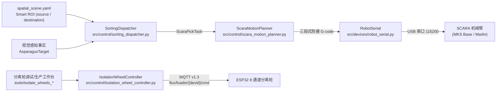

# 生产调度、执行器控制与外设接入

> **定位**：定义控制层（`src/control/`）、硬件驱动层（`src/devices/`）以及 SCARA / 分离轮 / 网络摄像机的生产与调试工具协议。  
> **核心源码**：`src/control/`、`src/devices/`、`tools/scara_*`、`tools/isolate_wheels_*`、`tools/net_camera_debug/`、`tools/tracker/`。

---

## 1. 控制与生产架构总览

---

## 2. Smart ROI 分选调度 (`SortingDispatcher`)

核心文件：`src/control/sorting_dispatcher.py`

- **自动解析工位角色**：从 `spatial_scene.yaml` 加载使能的 `RoiDefinition`：
  - `source` 进料区：`role == "source"` 或 `(role == "general" and category == "belt")`；
  - `destination` 落料槽：`role == "destination"` 或 `(role == "general" and category in ("tray", "wheel"))`，解析 `binding` 中的 `slot_index`、`capacity_max`（默认 5）、`grades`（默认 `["A", "B", "C"]`）以及落料中心坐标。
- **调度逻辑**：
  1. 优先选择最顶层（`is_topmost`）、无遮挡、高置信度目标；
  2. 按物料品质等级匹配未满（`current_count < capacity_max`）且启用的 `DestinationSlot`；
  3. 输出结构化 `ScaraPickTask` 交给 `ScaraMotionPlanner`，并维护各槽位实时根数与满溢阻断。

---

## 3. SCARA 轨迹规划与串口驱动

### 3.1 三段式防撞轨迹规划 (`ScaraMotionPlanner`)
核心文件：`src/control/scara_motion_planner.py`

每个 `ScaraPickTask` 严格按以下防撞序列生成绝对坐标（`G90`）Marlin G-code：
1. `G0 Z{safe_z} F{feedrate_xy}` — 提升至安全过渡高度（默认 `80.0 mm`），防平移撞料；
2. `G0 X{pick_x} Y{pick_y} R{pick_r} F{feedrate_xy}` — 水平对准物料抓取中轴；
3. `M3` — 预先张开气动夹爪；
4. `G1 Z{pick_z} F{feedrate_z}` — 低速垂直下探至夹持高度；
5. `M4` + `G4 P{dwell_ms}` — 闭合夹爪并保压延时（默认 `200 ms`）；
6. `G0 Z{safe_z}` — 垂直提刀脱离来料区；
7. `G0 X{drop_x} Y{drop_y} R{drop_r}` → `M3` → `G0 Z{safe_z}` — 平移至落料槽释放并提刀复位。

### 3.2 Marlin 串口通信与硬约束 (`RobotSerial`)
核心文件：`src/devices/robot_serial.py`（默认参数读自 `config/config.yaml` 的 `robot:` 节）
- 线程安全串口封装，支持指令发送 + `ok` 应答闭环、`M114` 末端坐标回读、`M400` 等待运动到位。
- **机械零位与轴映射红线**：
  - 机械零位刚性绑定为 `(X0, Y600, Z80, R90°)`；
  - Marlin 固件将 SCARA `R` 轴映射至 `E` 轴，设零必须执行 `M84` → `G92 X0.00 Y600.00 Z80.00 E90.00` → `M114`，**严禁** `G92 X0 Y0 Z0`。

### 3.3 SCARA 配套工具
- **SCARA 抓取生产**（`python -m tools.scara_production`，Dashboard `[S]`）：Smart ROI 感知调度看板、槽位统计与实机闭环。
- **SCARA 机械臂调试**（`python tools/scara_debug/app.py`，Dashboard `[7]`）：串口连接/仿真、限位诊断、点动、回零设零、舵机与 G-code 透传。
- **Robot 在线跟踪**（`python -m tools.tracker`）：实时解算 AprilTag 世界坐标，驱动 SCARA 安全路径联动并用 `M114` 对比到位偏差，用于相机位置校准验证。

---

## 4. 分离轮 MQTT 控制中枢 (`IsolationWheelController`)

核心文件：`src/control/isolation_wheel_controller.py`

### 4.1 MQTT 协议规格（v1.3）
- **Broker**：默认 `voicevon.vicp.io:1883`（`TOPIC_PREFIX = "flux/loader"`，`KEEPALIVE_S = 15`）。
- **设备发现与状态**：订阅 `flux/loader/+/state`（保留消息）、`flux/loader/+/done`、`flux/loader/+/log`，维护线程安全在线设备字典与日志环形缓冲。
- **设备状态枚举 (`WheelState`)**：`idle` / `running` / `offline` / `unknown`。
- **安全互锁**：仅当目标设备处于 `idle` 时受理生产指令，防止节拍并发冲突。
- **指令集**：
  - `load`：8 托架出料数量（`counts`）+ 动态速度倍率（`0.1x / 0.2x / 0.5x / 1.0x / 1.5x / 2.0x`）；
  - `motor`：单电机方向与角度精准调试；
  - `multi`：8 轴独立角度并发调试。

### 4.2 分离轮配套工具
- **分离轮生产工作台**（`python -m tools.isolate_wheels_production`，Dashboard `[0]`）：8 托架（1→8）物流拓扑看板、配方单拍/连续自动循环生产、速度倍率与循环间隔调优、CT 与 PPM 实时统计。
- **分离轮 MQTT 调试**（`python tools/isolate_wheels_debug/app.py`，Dashboard `[8]`）：设备发现、状态/日志监视、8 托架步进器与稳妥模式指令下发。

---

## 5. 相机服务与网络摄像机接入

### 5.1 统一相机服务 (`src/devices/camera_service.py` & `camera_streamer.py`)
- 统一封装 **Intel RealSense D435** 与 **USB 摄像头** 双物理后端，提供分辨率协商与分级回退、曝光/自动曝光控制及内参回调。
- 所有 `tools/` 应用必须通过 `CameraService` 操作相机，严禁直接调用 `pyrealsense2`。

### 5.2 手机网络摄像机调试 (`tools/net_camera_debug/app.py`，Dashboard `[9]`)
- 对接 `android_as_camera` 手机网络摄像机：
  - **MQTT 发现与远控**：订阅 `camera/+/state`，向 `camera/{id}/cmd` 下发 JSON 控制（推流启停、前后摄切换、变焦、拍照、录像、移动侦测）；
  - **RTSP 拉流预览**：依据 `state` 上报 IP 通过 TCP 交错拉取 `rtsp://{ip}:8554/live` 实时画面。
- 用于空间标定时，务必遵守 [多摄变焦与标定稳定性机理.md](knowledge/多摄变焦与标定稳定性机理.md) 中的镜头与变焦锁定规范。

---

## 6. 单根分拣极简生产闭环 (`SorterRuntime`)

面向 2D 定焦相机 + 外部硬触发 + USB 串口/RS485 下位机的单根芦笋测量分拣产线：

- **核心模块**：
  - `src/vision/planar_rectifier.py`（`PlanarRectifier`）：基于机架固定 4 枚 AprilTag 16h5 求解单应矩阵 $H$，输出严格等比鸟瞰 ROI，并在空闲巡检发现相机被碰歪时自动热更新恢复，失锁时熔断拦截；
  - `src/control/grading_engine.py`（`GradingEngine`）：按配置顺序将有效长度/直径映射至分拣等级槽位（未命中或无效返回剔除等级 `0`）；
  - `src/devices/sorter_serial.py`（`SorterSerialLink`）：线程安全串口文本行协议（`TRIG,<seq>` / `RES,<seq>,<grade>,<len_mm>,<diam_mm>,<status>` / `PING` ↔ `PONG,<ready>`）；
  - `tools/sorter_runtime.py` + `config/sorter_station.yaml`：极简单一生产主程序，支持单屏监控、`--sim` 无串口仿真联调及 `--headless` 无界面服务模式。
