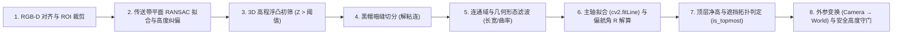

# 视觉感知管线与几何测量

> **定位**：汇总 `spatial_vision` 的三大视觉能力：3D RGB-D 堆叠抓取感知、纯 2D 多管线注册与对比框架、单根芦笋精密几何测量。  
> **核心源码**：`src/vision/`、`tools/asparagus_pose_studio/`、`tools/asparagus_measure_studio/`。

---

## 1. 视觉层职责与解耦原则

- **纯客观事实输出**：视觉层只负责从图像/深度帧中提取客观几何事实（目标坐标、主轴偏航角、顶层判定、长度/直径），**不侵入运动规划或业务调度**。
- **零 UI 依赖**：`src/vision/` 严禁 `import src.ui`。

---

## 2. 3D RGB-D 堆叠抓取感知 (`AsparagusAnalyzer`)

核心文件：`src/vision/asparagus_analyzer.py`  
入口签名：`analyze(color_bgr, depth_mm) -> List[AsparagusTarget]`

### 关键工程要点
- **传送带倾角纠偏**：针对 $\pm 30^\circ$ 大倾角俯视，通过最小二乘/RANSAC 拟合黑色皮带平面，将原始深度矫正为以台面为 $Z=0$ 的正交高度图。
- **湿润反光抗噪**：利用脊线前 15% 高分位高程替代单点均值，规避蜡质/水膜红外过曝导致的 0 值黑洞。
- **黑帽暗缝切分**：利用形态学 Black-Hat 提取并排贴合芦笋间的微小暗缝阴影，切开粘连实例。
- **安全抓取守门**：外参异常或目标高度越界（$Z \notin [5, 45]\text{ mm}$）时强制拦截，禁止生成下探指令。

---

## 3. 纯 2D 多算法管线框架 (`src/vision/pipelines/`)

为支持无深度相机（如 USB / 手机网络摄像机）及复杂粘连场景的算法横向评测，系统提供插件化的管线注册与对比框架。

### 3.1 抽象基类与注册表
- **基类**：`src/vision/pipelines/base_pipeline.py`（`BaseAsparagusPipeline`）
  - `get_steps() -> List[PipelineStep]`：声明内部中间步骤（GUI 据此动态渲染步骤切换药丸，零侵入适配新算法）。
  - `run(color_bgr, depth_mm, plane_coeff, frame_transform, frame_calib_source, nominal_z_mm) -> PipelineResult`：返回标准化目标列表 `targets`、单帧耗时 `elapsed_ms`、步骤可视化快照 `step_snapshots` 与自定义指标 `extra_metrics`。
- **注册表**：`src/vision/pipelines/registry.py`（`PipelineRegistry`）
  - 通过 `@PipelineRegistry.register(key, display_name)` 注册；
  - `src/vision/pipelines/__init__.py` 的显式导入顺序决定 GUI 下拉列表顺序。

### 3.2 已注册算法路线家族
| 系列 | 模块文件 | 核心思想 |
| :--- | :--- | :--- |
| **F 系列（默认首选）** | `f1_green_medial_axis_pipeline.py`、`f2_exgr_watershed_pipeline.py` | 绿茎颜色提取 + 中轴线 / ExG 分水岭分割（F1 置顶为默认首选） |
| **A 系列** | `a_ridge_tracing_pipeline.py` | 脊线追踪 |
| **B 系列** | `b1_polarity_scanline_pipeline.py`、`b2_segment_topology_pipeline.py` | 极性扫描线与线段拓扑分析 |
| **C 系列** | `c1_skeleton_thinning_pipeline.py`、`c2_frangi_vesselness_pipeline.py` | 骨架细化与 Frangi 管状增强滤波 |
| **H 系列（经典非 ML）** | `h1_sato_pipeline.py`、`h2_skeleton_pipeline.py`、`h3_fast_marching_pipeline.py`、`h4_graph_tracing_pipeline.py`、`h5_phase_congruency_pipeline.py`、`h6_steerable_pipeline.py` | Sato 管状滤波、距离骨架、Fast Marching、图追踪、相位一致性、可操纵滤波 |
| **Y 系列（占位）** | `y1_stub_pipeline.py` | 深度学习/外部模型接入桩 |

辅助解耦组件：`multi_object_separator.py`（多目标分离）、`occlusion_peeler.py`（遮挡剥离）。

### 3.3 顶层抓取位姿工作室 (`tools/asparagus_pose_studio/`)
- 启动：`python -m tools.asparagus_pose_studio`（或 Dashboard `[4]`）。
- 优先加载当前工位 `production/raw_images/` 样本，支持自由切换上述所有已注册管线、逐步骤检视 `step_snapshots` 与批量评估。

---

## 4. 单根芦笋精密几何测量 (`SingleAsparagusMeasurer`)

核心文件：`src/vision/single_asparagus_measurer.py`  
配套工具：`tools/asparagus_measure_studio/`（启动：`python -m tools.asparagus_measure_studio` 或 Dashboard `[5]`）

### 4.1 测量流程与输出契约 (`SingleAsparagusMeasurement`)
1. **双源 ROI 定位**：支持读取工位 `spatial_scene.yaml` 的 3D ROI 投影框，或在画面手动画 2D ROI 框。
2. **绿茎 + 白根联合提取**：在 HSV 空间分别提取绿茎与白根前景并锁定 ROI 内唯一单根本体（过滤 `< min_area_px` 噪点）。
3. **三级物理尺度解析 (`scale_source`)**：
   - `depth_intrinsics`（优先）：深度图 + 相机内参；
   - `tag_plane`（次选）：AprilTag 平面投影标定；
   - `manual_scale`（兜底）：手动 `fallback_mm_per_px`（默认 `0.25 mm/px`）。
4. **固定朝向中轴排序**：沿 PCA 主轴切片提取平滑中轴线，按配置的固定朝向（`left_to_right` / `right_to_left` / `top_to_bottom` / `bottom_to_top`）统一为 **根 → 尖** 顺序。
5. **白绿分界与双核心指标**：
   - 沿中轴检测切片绿色占比（`green_ratio_threshold = 0.55`），定位白根与绿茎分界线；白根长度低于 `min_white_root_mm`（默认 `3.0 mm`）按全绿处理；
   - **有效长度 (`effective_length_mm`)**：仅绿色段长度（白绿分界线 → 笋尖；全绿时为根部切口 → 笋尖）；
   - **特征直径 (`diameter_mm`)**：从白绿分界线（或全绿根部切口）向头部偏移 `diameter_offset_mm`（默认 `20.0 mm`）处的垂直截面直径。
